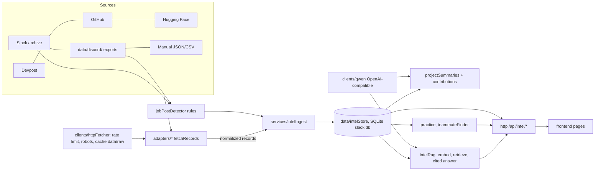

# Hackathon Intel — final report

Branch: `feature/hackathon-intel` (base `refactor/frontend-backend-layout`). Claude Doc: not created (see "Known gaps").

## 1. What was built
One tool for four jobs: (1) job/internship postings found in the owner's Slack archive and Discord exports, (2) how 2026 SF winning projects were built, (3) hackathon practice drills from real past tracks, (4) finding teammates (winners, what they built, how to reach them). Scope change of 2026-11-17 applied: **no ATS/company job-board scraping; no live Discord**.

### Changes by commit
- `14905cc` spec, plan, progress tracker; `npm test` fixed for Node 22
- `0e80464` Qwen/intel config + polite `httpFetcher`
- `a9f5b20` `intelStore` (schema, idempotent upserts, queries)
- `ddcc4e9` adapter registry, record validation, Devpost parsers
- `0d655c0` eval harness + `intelIngest` + CLI
- `4a1672f` GitHub adapter, non-clobbering upserts
- `7cc2823` Hugging Face, manual import, Slack adapters
- `5999031` fetcher hardening (https-only, SSRF/redirect checks, robots, timeout), sponsor dedupe
- `46be536` ATS jobs adapter — **later removed** in `f430e88`
- `4bd2137` Qwen client; `858d830` projectSummaries + groundedness; `d117a2c` contributions; `6ab1aaf` intelRag
- `8235cb1` review fixes, RAG eval set, `intel:bench`
- `f430e88` scope change applied; `a16c923` jobPostDetector + eval; `08230b3` slackJobs; `2348e16` discord adapter; `a8f740a` job-extraction review fixes
- `efc2cc9` `/api/intel/*` routes; `72af3d3` practice + teammateFinder
- `def676f` Winners + Project pages, `people` table collision fix; `427c57d` Jobs, Builders, Practice, Ask pages + review fixes
- (lock commits omitted)

## 2. Architecture

Layering: http → services → data/clients → lib. Named exports only, no import-time side effects.

## 3. Data model (SQLite, in the existing slack.db)
`hackathons`, `projects` (github_stats, hf_info JSON), `hackathon_people` (renamed from `people`, which collided with the Slack table), `project_members`, `contributions`, `sponsors`, `hackathon_sponsors`, `project_prizes`, `jobs` (source, channel, permalink, link, snippet). Cross-references use source URLs; stub rows are filled when the target arrives. Upserts are idempotent and non-clobbering (COALESCE; `is_winner` ratchets up).

## 4. Adapters
`devpost`, `github`, `huggingface`, `slack` + `slackJobs`, `discord`, `manualImport`. Each exports `name` and `async fetchRecords(options, deps)` returning `{kind, source, sourceUrl, data}` records (`lib/records.js` validates). **To add one:** create `backend/src/adapters/<name>.js`, build records with `makeRecord`, add it to `adapters/registry.js`, save a small fixture under `backend/test/fixtures/<name>/` and test the pure parse functions; no service changes needed. Run with `npm run intel:ingest -- --adapter <name>`.

## 5. Frontend
Vanilla-JS router pages: Winners (`#/winners`, filter hackathon/sponsor/stack), Project detail (`#/winners/:id`), Jobs (filter source/channel/company), Find teammates (`#/builders`), Practice (timed ideation, then reveal), Ask winners (`#/ask-winners`). Decisions: all text escaped via `html\`\``; scraped/chat URLs become anchors only if https without credentials (`utils/safeLink.js`), `rel=noopener noreferrer`; race guards on async loads; empty-state copy that says what to do next. Smoke-tested in a browser at desktop and 390px (no overflow, XSS/`javascript:` inert). No automated contrast audit was run.

## 6. Eval and benchmark results (2026-11-18, commit 4a1bbd2)
All fixtures are **SYNTHETIC** (hand-written, labels written alongside the parsers), so 1.0 scores are regression guards, not evidence of live accuracy.

| metric | value |
|---|---|
| winner precision / recall | 1.0 / 1.0 |
| team-member F1 | 1.0 |
| sponsor-link accuracy | 1.0 |
| SF+2026 filter accuracy | 1.0 |
| job detect P / R | 1.0 / 1.0 |
| job company / location / link accuracy | 0.9 / 0.9 / 1.0 |
| RAG dev recall@5 / MRR | 1.0 / 0.938 (27 q) |
| RAG heldout recall@5 / MRR | 1.0 / 0.917 (15 q) |
| unknown-gate dev / heldout | 1.0 / 0.667 (heldout not tuned) |
| answer correctness, citation accuracy, unknown rate | skipped (no Qwen endpoint) |
| ingest | ~21.7k records/s (fixtures) |
| embed | 3.1 ms / 100 chunks (hash embedder) |
| retrieval p50 / p95 | 0.02 / 0.23 ms |
| ask p50 / p95 (mock Qwen) | 0.02 / 0.07 ms |

History: `docs/evals/history.csv`, `docs/evals/bench-history.csv`. No metric changed between sessions. The RAG numbers use a hash embedder, so they check plumbing only; MiniLM/Qwen quality is unmeasured. Tests: 122 pass.

## 7. Known gaps / blocked sources
- **L1 live Devpost: blocked.** `devpost.com` returns 403 on CONNECT from the cloud egress proxy (retried 2026-11-18). Devpost selectors are unverified against real pages. Run `npm run intel:ingest -- --adapter devpost` locally and re-label the fixtures from real captures.
- **L2 live GitHub: blocked.** Cloud GitHub API access is scoped to this repo only (403 for others), and there are no ingested projects with repos anyway. Not faked.
- Qwen not reachable in cloud: summaries, contributions and answer evals are untested against a real model.
- Claude Doc not created: the Claude-Docs connector is available, but this unattended run did not publish the report externally; the markdown here is the source of truth.
- Deferred review items: summary regeneration on source change, SQL-side `listJobs` filters, `teammateFinder` stack lookup is O(N) queries per search, builders/practice/ask-winners are missing from the phone tab bar, robots `*`/`$` patterns unsupported, no cache TTL.
- Without Devpost data the Winners/Teammates/Practice pages are empty until ingest runs; Jobs work as soon as Slack/Discord data exists.

## 8. Decisions made on the owner's behalf
See `docs/superpowers/decisions.md` (all sessions, one-line whys). Highlights: scope change applied and ATS adapter removed; intel tables live in slack.db; `people` → `hackathon_people` after a collision bug; no fabricated contributions (bio alone ⇒ Unknown); uncited answers ⇒ unknown; DMs and Discord DM exports never become job posts; job links stored only if https; detail routes use `?id=`.

## 9. Run locally
```
npm ci && npm test
# Qwen via Ollama
ollama pull qwen3:8b            # serves http://localhost:11434/v1
cp .env.example .env            # QWEN_BASE_URL, QWEN_MODEL, optional GITHUB_TOKEN, SLACK_WORKSPACE_URL=https://<team>.slack.com
npm run intel:ingest -- --adapter devpost --max-hackathons 5
npm run intel:ingest -- --adapter github
npm run intel:ingest -- --adapter slackJobs   # jobs from the synced Slack archive
npm run intel:ingest -- --adapter discord
npm run intel:summarize
npm run intel:ask -- "Which winning projects used Qwen?"
npm run intel:eval && npm run intel:bench
npm start                       # open the app; pages under #/winners, #/builders, #/ask-winners
```
**Discord exports:** use DiscordChatExporter (run on your machine) to export each server channel you belong to as **JSON**, e.g. `DiscordChatExporter.Cli export -t <your token> -c <channel id> -f Json -o data/discord/`. Drop the `.json` files into `data/discord/` (gitignored). DM exports are skipped by design. Use only servers you are allowed to export; never commit tokens or `data/`.
